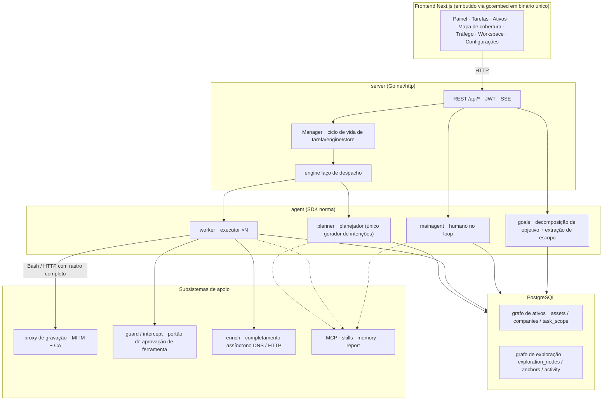
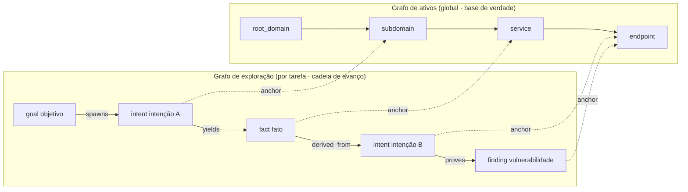
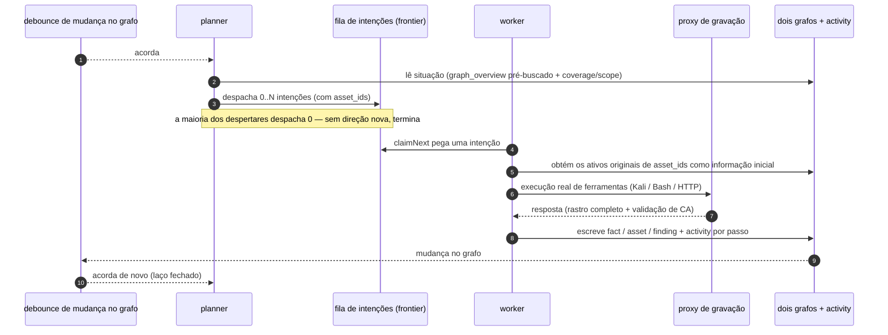
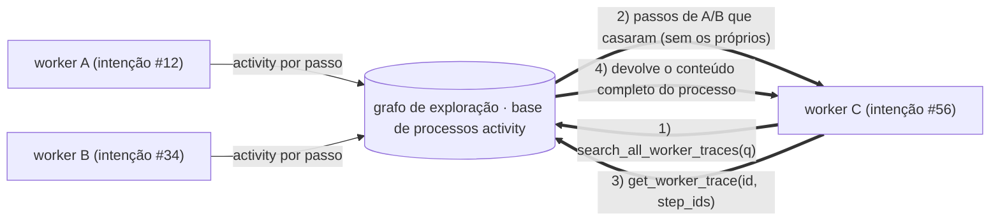
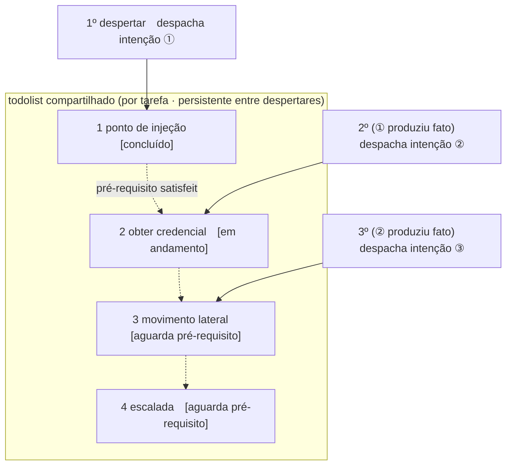

<div align="center">

# ARTEX

Sistema autônomo de pentest com IA (backend Go + frontend Next.js)

🌐 **Demo online**: [https://artex-demo-ruoji6.vercel.app/](https://artex-demo-ruoji6.vercel.app/)

</div>

> Este repositório é um fork mantido de [RuoJi6/ARTEX](https://github.com/RuoJi6/ARTEX), que preserva o histórico original e a licença AGPL-3.0 de https://github.com/Autumn-27/ARTEX. Os pacotes de release vêm dos Releases deste repositório; a imagem Docker [ruoji6/artex](https://hub.docker.com/r/ruoji6/artex) é construída e publicada pelo GitHub Actions deste repositório.

---

## Agradecimentos

Equipe de segurança 米斯特 (Mister)

洺熙

wowo

## Capturas de tela

> A interação completa está na [demo online](https://artex-demo-ruoji6.vercel.app/).

| Painel (visão geral / consumo de tokens / fluxo de atividade) | Lista de tarefas |
| :---: | :---: |
|  |  |

| Tarefa · processo de execução (sessão / chamadas de ferramenta) | Cadeia de exploração |
| :---: | :---: |
|  |  |

| Achados | Ativos |
| :---: | :---: |
|  |  |

| Mapa de cobertura de ativos (layout de forças · testados destacados · nós recolhíveis) |
| :---: |
|  |

| Gravação de tráfego | Conversa com humano no loop |
| :---: | :---: |
|  |  |

| Gestão de agentes | Configuração de LLM |
| :---: | :---: |
|  |  |

| Aprovação de interceptação | Logs do backend |
| :---: | :---: |
|  |  |

---

## Detalhes do registro de aprovações

O «Histórico de aprovações» global, a «Aprovação de interceptação» dentro da tarefa e os cartões de aprovação na conversa podem ser expandidos para ver detalhes. A estrutura de exibição segue o
[componente de detalhes de aprovação do AegisHook](https://github.com/RuoJi6/AegisHook/blob/main/web/src/components/CallDetail.vue), mantendo os componentes e o tema do ARTEX.

## Sincronização de ativos (ScopeSentry)

É possível sincronizar ativos diretamente do [ScopeSentry](https://github.com/Autumn-27/ScopeSentry), sem recoletar:

- Na página «**Sincronização de ativos**», informe o endereço e a API Key do ScopeSentry para conectar a fonte;
- Escolha os alvos e tipos de ativo a sincronizar por **projeto** ou **tarefa** (domínio / subdomínio / IP / porta / site / endpoint…);
- Importe com um clique e agrupe pelo escopo de ativos da empresa, entrando direto no grafo de ativos do ARTEX para o agente explorar.

---

## Publicar sua própria demo online (atualiza junto com o release oficial)

A demo roda apenas o frontend `web/`, com `NEXT_PUBLIC_MOCK=1` na build, sem Go, PostgreSQL nem chave de modelo. A interface usa dados simulados e não executa varreduras reais.

Fluxo de publicação: quando o pacote, o `SHA256SUMS` e a imagem Docker do release oficial são publicados com sucesso → o job `demo` do `release.yml` chama o `demo.yml` → faz checkout da tag → constrói o frontend mock → publica no domínio de produção fixo da Vercel. Push comum na main, criação de tag isolada, release com falha, rascunho e pré-release não atualizam a demo. Os dados de demonstração de recursos novos ainda precisam ser mantidos manualmente em `web/src/lib/mock/`.

### Primeira configuração na Vercel

1. Crie um projeto vazio na sua conta Vercel com um nome (por exemplo `artex-demo-ruoji6`). Mantenha **Git desconectado** para evitar deploy automático em cada commit. O `web/vercel.json` também desativa o deploy automático por Git.
2. Em **Settings → Build and Deployment**, escolha **Next.js**, Node.js **22.x**, instalação `npm ci` e build `npm run build`, mantendo o Output Directory padrão. **Deixe o Root Directory vazio**: o workflow chama a CLI da Vercel a partir do diretório `web/` já checado, então não preencha outra camada `web`.
3. Em **Environment Variables**, adicione `NEXT_PUBLIC_MOCK=1`, aplicada ao menos em **Production**. Não defina `NEXT_EXPORT=1` nem informe conexão de banco ou chave de modelo.
4. Em **Settings → General** do projeto, copie o **Project ID**; em **Settings → General** do time, copie o **Team ID** (corresponde a `VERCEL_ORG_ID`). Confirme que o domínio de produção está em **Domains**.
5. Em **Account Settings → Tokens** da Vercel, crie um token de deploy com escopo no time do projeto e validade adequada. Salve em **Settings → Secrets and variables → Actions → Secrets** do repositório GitHub como `VERCEL_TOKEN`. Não grave o token no repositório, no README ou em chats; renove o Secret quando expirar.

Na mesma página de configurações do GitHub, adicione em **Variables**:

| Variável | Valor |
| --- | --- |
| `VERCEL_ORG_ID` | Team ID da Vercel |
| `VERCEL_PROJECT_ID` | Project ID da Vercel |
| `DEMO_URL` | URL pública fixa de produção, com `https://`, por exemplo `https://artex-demo-ruoji6.vercel.app` |

### Primeiro deploy e novas tentativas

Depois de mesclar a configuração na branch padrão, abra **Actions → deploy-demo → Run workflow**, escolha a branch `main` e deixe a tag vazia ou informe o release estável mais recente (por exemplo `v0.3.21`). O workflow aceita somente o release estável mais recente já publicado, com os cinco pacotes de plataforma e o arquivo de checksums, e também consegue publicar releases estáveis anteriores que ainda não contenham este workflow. Não é preciso republicar o release nem mover tags existentes.

O workflow define o projeto de demo com framework Next.js, Node 22.x, raiz vazia, instalação `npm ci`, build `npm run build`, garante `NEXT_PUBLIC_MOCK=1` em Production e então associa o domínio indicado em `DEMO_URL`. Use um projeto dedicado; deploys seguintes mantêm essa configuração.

Após o sucesso, acesse o domínio de produção e confira `tag`, `commit` e `mock: true` em `/demo-version.json`. Confirmado o acesso, troque o link antigo da demo no topo do README e na área de capturas pelo seu domínio.

A partir daí, publicar versões mais novas pelo fluxo normal atualiza a demo automaticamente. Se o deploy da demo falhar, os pacotes e a imagem já publicados continuam válidos e a demo antiga costuma seguir no ar; corrija a configuração e rode apenas `deploy-demo` de novo, sem republicar o release inteiro. Quando duas versões são publicadas ao mesmo tempo, os deploys são serializados e conferem o latest antes da build e antes de subir, para que uma build desatualizada não sobrescreva a nova.

O fluxo de release chama o job de deploy diretamente porque um Release criado com o `GITHUB_TOKEN` não dispara outro workflow `release: published`. O `demo.yml` também escuta Releases publicados manualmente pela interface, com as mesmas verificações de estabilidade, pacote completo e latest; a repetição manual usa `deploy-demo`.

---

## Instalação

> Exige banco **PostgreSQL**; a exploração precisa de **LLM** (`ANTHROPIC_API_KEY` ou `OPENAI_API_KEY`, também configurável pela interface).

### Forma 1: script de instalação em um clique (recomendado)

```bash
git clone https://github.com/RuoJi6/ARTEX.git
cd ARTEX
./install.sh
```

O script detecta ou instala o Docker → e pede para escolher **① tudo em Docker** ou **② compilar e rodar local**:

- **① tudo em Docker**: informe uma senha do Postgres (Enter gera aleatória) → grava o `.env` → `docker compose up -d`.
- **② local**: escolha o banco (usar um existente / subir um em Docker) → gera `config.json` → compila o binário único com o frontend embutido → inicia.

Depois de instalar, abra **http://localhost:8787** (o primeiro acesso cai em `/setup` para definir a senha de administrador).

### Forma 2: Docker Compose (manual)

```bash
git clone https://github.com/RuoJi6/ARTEX.git
cd ARTEX
cp .env.example .env          # preencha POSTGRES_PASSWORD e, opcionalmente, ANTHROPIC_API_KEY
docker compose up -d          # baixa a imagem ruoji6/artex + postgres
# → http://localhost:8787
```

A imagem já traz ferramentas comuns (ripgrep/curl/vim/npm/nmap…); `./skills` e `./data` persistem por bind mount.

No `.env`, `ARTEX_IMAGE=ruoji6/artex` e `ARTEX_TAG=latest` usam a imagem mais recente; também é possível fixar `v0.3.17` (endereço completo `ruoji6/artex:v0.3.17`). A imagem suporta `linux/amd64` e `linux/arm64`, e o Docker escolhe a arquitetura do host automaticamente — ARM64 Kali não precisa compilar. Mude `POSTGRES_PASSWORD` no primeiro deploy; rodar o serviço não exige token de publicação no Docker Hub.

MCP remoto pode usar `http` (Streamable HTTP) ou `sse` (SSE legado) nas configurações do sistema.
Serviços SSE antigos costumam abrir o fluxo de eventos com `GET /sse` e receber as
requisições JSON-RPC pelo `/message?sessionId=...` devolvido pelo serviço; na configuração,
preencha a URL com `/sse` e o cabeçalho como
`Authorization=Bearer <token>`.

### Forma 3: download do binário pré-compilado (Releases)

Baixe em [Releases](https://github.com/RuoJi6/ARTEX/releases) o zip da sua plataforma; ao descompactar você tem `artex` + `start.sh` (no Windows, `start.bat`) + `skills/` + `config.example.json`. Linux ARM64 (inclusive ARM64 Kali) usa `linux-arm64`; x86_64 usa `linux-amd64`:

```bash
cp config.example.json config.json   # preencha a conexão do banco
./start.sh                           # → http://localhost:8787
```

> Inicie com `start.sh` / `start.bat`, não com `./artex` direto. Ele é um script supervisor: decide pelo código de saída se relança o programa, e **a [atualização em um clique](#forma-1-atualização-em-um-clique-recomendado) da página depende dele para trocar o binário**. Rodando `./artex` direto, após atualizar o programa não é relançado.
> Para deixar em segundo plano: `nohup ./start.sh >artex.log 2>&1 &`.

### Forma 4: compilar o binário único a partir do código

```bash
# 1) export estático do frontend
cd web && npm ci && npm run build:static && cd ..
# 2) cria o diretório de embutidos
mkdir -p server/webui/dist
# 3) copia os arquivos
cp -r web/out/. server/webui/dist
# 4) compila (só com -tags embedui o frontend é embutido)
CGO_ENABLED=0 go build -tags embedui -o artex ./cmd/artex
./start.sh
```

### Forma 5: gerar os pacotes de release multiplataforma

O `build.sh` constrói e embute o frontend, remove informações de depuração pelo linker do Go e compacta os arquivos em zip. No modo release ele gera, por padrão, zips para Linux amd64/arm64, macOS amd64/arm64 e Windows amd64:

```bash
./build.sh --release
# saída: dist/artex-0.3.3-*.zip
```

O binário autoextraível do UPX pode ser incompatível com alguns kernels Linux, ambientes virtualizados ou políticas de segurança, então fica desativado por padrão. Use `ARTEX_TARGETS` para definir alvos; se o ambiente de destino for compatível, passe `--upx` explicitamente para reduzir o binário:

```bash
ARTEX_TARGETS=linux/amd64,windows/amd64 ./build.sh --release
./build.sh --target linux/amd64 --upx
```

---

## Atualização

> Atualizar troca só o programa, sem tocar nos dados: o volume `pgdata` do Postgres, o `./data` (jwt.key / SQLite etc.) e o `./skills` são preservados. **A migração do banco não é manual**: a cada início o `artex` roda `schema.sql` de forma idempotente (com `ADD COLUMN` / `CREATE INDEX IF NOT EXISTS`), ou seja, “reiniciar é migrar”. Ainda assim, faça backup de `./data` e do banco antes.

### Forma 1: atualização em um clique pela página (recomendado)

Em **Configurações do sistema** (barra lateral → `/system/settings`), no cartão **Versão e atualizações**, é possível verificar e instalar a nova versão sem acessar o servidor.

O programa construído neste repositório verifica atualizações no release estável mais recente de `RuoJi6/ARTEX`, ignorando rascunhos e pré-releases. Binários oficiais antigos ainda apontam para o repositório do autor original, então a primeira troca precisa ser manual; depois disso, publicar uma versão de três partes mais alta já permite atualizar pela página. Apenas push na main ou tag sem Release não gera versão instalável.

Ao clicar em «Atualizar»: baixa o pacote da plataforma → compara o `SHA256SUMS` do Release → roda um teste rápido do binário novo com `-h` → grava como `artex.new` → o programa encerra e o `start.sh` / `start.bat` o relança concluindo a troca. A página espera e recarrega quando a nova versão sobe.

- **Falha não deixa binário ruim**: se a verificação ou o teste falhar, o arquivo é descartado e a versão atual continua; se a nova versão falhar 3 inícios seguidos, volta sozinha para `artex.old` (a que falhou fica como `artex.failed` para diagnóstico).
- **Sempre é possível voltar**: a versão anterior fica em `artex.old` e o cartão tem «Reverter para a versão anterior». O esquema do banco não reverte.
- **A atualização interrompe tarefas em execução** — atualizar é reiniciar, então faça em momento ocioso.
- **Build de desenvolvimento não recebe atualização**: quando a versão é `dev` ou um `git describe` com sufixo, a atualização fica desativada para não sobrescrever o binário de depuração.
- **No Docker troca o programa, não a imagem**: a cadeia de ferramentas da imagem (playwright / nmap etc.) não sobe junto, e `docker compose up -d` volta à versão da imagem. Para atualizar a imagem também, use `docker compose pull artex && docker compose up -d artex`.
- **Proxy de atualização (opcional)** usa o mesmo padrão dos outros proxies («campo de endereço + salvar»). Informe um proxy dedicado, por exemplo `http://127.0.0.1:7897`; suporta `http://`, `https://`, `socks5://`, `socks5h://` e autenticação por usuário e senha. Limpar e salvar volta à conexão direta, sem influência do proxy global ou de `HTTP_PROXY` / `HTTPS_PROXY`. Depois de salvar, a verificação é refeita e a checagem, a validação e o download do pacote usam a mesma saída. A atualização baixa somente de domínios do GitHub, sempre por HTTPS.
- O proxy é acessado pelo **servidor** do ARTEX. Dentro do Docker, `127.0.0.1` é o próprio contêiner; se o proxy roda no host, use um endereço alcançável pelo contêiner (no Docker Desktop, normalmente `http://host.docker.internal:7897`) e permita o acesso à porta do proxy.

### Mantenedores: publicar atualizações online pelo GitHub Actions

O workflow de release é `.github/workflows/release.yml`. O push de uma tag estável dispara a build, e também é possível reexecutar um release com falha em Actions → release → Run workflow informando uma tag existente. A tag precisa ser `v<maior>.<menor>.<revisão>`, como `v0.3.17`; versões seguintes precisam ser mais altas que a que o usuário está rodando.

```bash
git push origin main
git tag v0.3.17
git push origin v0.3.17
```

O workflow fixa o commit da tag, exporta o frontend com Node.js 22, compila com a versão de Go indicada no `go.mod` os cinco binários de plataforma com o frontend embutido e gera os ZIPs e o `SHA256SUMS`. As imagens AMD64 e ARM64 são construídas em runners nativos do GitHub, cada uma conectando a um PostgreSQL temporário para validar o início, a versão e o frontend embutido; aprovadas as duas arquiteturas, publica a imagem multiarquitetura com tag de versão e `latest`. Depois do sucesso da imagem, envia os ZIPs e checksums e por último publica o Release. Uma versão já publicada não pode ser sobrescrita: publique uma tag nova.

O mantenedor configura no repositório, em Settings → Secrets and variables → Actions, a variável `ARTEX_DOCKER_IMAGE` (usuário/nome da imagem no Docker Hub) e os Secrets `DOCKERHUB_USERNAME` e `DOCKERHUB_TOKEN` (com permissão de push). Os pacotes sobem com o `GITHUB_TOKEN` nativo; a imagem vai ao Docker Hub com essas credenciais. As credenciais servem só ao login do workflow e não entram no código nem na imagem. O endereço da imagem também fica em `.env.example` e no padrão do Compose.

### Migrar um deploy Docker existente para a imagem deste repositório

No diretório do deploy atual, faça backup do `.env`, do arquivo Compose, do `data/` e dos dados do PostgreSQL, mantendo o volume do banco e o mount de skills. Defina `ARTEX_IMAGE` no `.env` para a imagem deste repositório e `ARTEX_TAG` para a versão desejada; se o Compose antigo ainda fixa a imagem do autor original, crie o override abaixo (se já existir um, mescle a configuração de imagem):

```yaml
# docker-compose.override.yml
services:
  artex:
    image: ${ARTEX_IMAGE}:${ARTEX_TAG:-latest}
```

E atualize apenas o contêiner da aplicação:

```bash
docker compose pull artex
docker compose up -d --no-deps artex
curl --fail http://127.0.0.1:8787/api/health
docker compose logs --tail=50 artex
```

Mantenha o diretório do deploy e o nome do projeto Compose para que `./data`, `./skills` e o volume do PostgreSQL continuem apontando para os dados originais. Depois da migração, o programa verifica atualizações em `RuoJi6/ARTEX`; daí em diante é possível atualizar o programa pela página ou a imagem inteira pelos comandos acima.

Na primeira migração de um deploy Docker, descompacte no host o ZIP ARM64 já verificado, faça backup do programa original e substitua apenas o `/app/artex` do contêiner existente. Por exemplo, com o contêiner chamado `artex-artex-1`:

```bash
# execute no diretório de download; confira o ZIP pelo SHA256SUMS antes de descompactar.
sha256sum --ignore-missing --check SHA256SUMS
unzip artex-0.3.17-linux-arm64.zip
sudo docker stop artex-artex-1
sudo docker cp artex-artex-1:/app/artex ./artex-before-migration
sudo docker cp ./artex-0.3.17-linux-arm64/artex artex-artex-1:/app/artex
sudo docker start artex-artex-1
curl --fail http://127.0.0.1:8787/api/health
```

Isso preserva o banco, o `data` e o mount de skills. Entre nas configurações do sistema para conferir a origem de atualização e a versão. O programa substituído dentro do contêiner continua na camada gravável: apagar ou recriar o contêiner perde a troca, então ao recriar use uma imagem que já contenha o programa deste repositório. Reverter o programa não reverte a migração do banco; faça backup do banco e do `data` antes de atualizar.

### Forma 2: script de atualização em um clique

```bash
cd ARTEX
./update.sh
```

O script oferece opcionalmente `git pull`, depois pede para escolher **① atualizar em Docker** ou **② compilar e atualizar local** (equivalente ao `install.sh`):

- **① Docker**: permite indicar a tag da imagem (Enter mantém o `ARTEX_TAG` do `.env`, padrão `latest`) → `docker compose pull` → `docker compose up -d` (reiniciar com a imagem nova já migra).
- **② local**: reconstrói o frontend estático → recompila `./artex` (vale após reiniciar o processo).

### Forma 3: Docker Compose (manual)

```bash
cd ARTEX
git pull                       # atualiza compose / scripts (opcional)
# versão específica: defina ARTEX_TAG=v0.3.17 no .env; sem isso, usa latest
docker compose pull artex
docker compose up -d artex     # reinicia com a imagem nova → migra o schema
docker image prune -f          # limpa imagens antigas (opcional)
```

### Forma 4: binário pré-compilado (Releases)

Baixe em [Releases](https://github.com/RuoJi6/ARTEX/releases) o zip da nova versão, pare o processo antigo e sobrescreva `artex` e `skills/` (mantendo seu `config.json` e `data/`), depois reinicie:

```bash
cp -r <diretório-descompactado>/skills ./ && cp <diretório-descompactado>/artex ./
./start.sh
```

### Forma 5: compilar do código

```bash
git pull
cd web && npm ci && npm run build:static && cd ..
mkdir -p server/webui/dist
cp -r web/out/. server/webui/dist
CGO_ENABLED=0 go build -tags embedui -o artex ./cmd/artex
# reinicie ./start.sh
```

---

## Configuração

**Banco** (`config.json`, ou sobrescrito pela variável `ARTEX_PG_DSN`):

```json
{
  "database": {
    "host": "127.0.0.1", "port": 5432,
    "user": "artex", "password": "yourpass",
    "dbname": "artex", "sslmode": "disable"
  }
}
```

**LLM**: `export ANTHROPIC_API_KEY=sk-...` (ou `OPENAI_API_KEY`), também preenchível na página «Configuração de LLM» da interface.
Opcional: `ARTEX_LLM_PROVIDER` / `ARTEX_LLM_MODEL` / `ARTEX_LLM_BASE_URL` / `ARTEX_LLM_PROXY`.

**User-Agent HTTP**: o WebFetch embutido (worker / planner / main / chat), o completamento automático de HTTP de ativos, a sondagem de conectividade de saída, as ferramentas HTTP personalizadas, o repetidor de requisições, a autoatualização pelo GitHub e, opcionalmente, os scripts `harvest_static.py` / `spider_mpa.py` escolhem aleatoriamente um de 20 User-Agents de navegador, sem carregar o nome da ferramenta. No Go, a escolha acontece uma vez por requisição lógica e é reaproveitada em redirecionamentos e nas novas tentativas diretas do WebFetch quando o proxy falha; nos scripts Python, uma vez por execução, mantendo entrada, download e novas tentativas iguais. A escolha aleatória admite repetição e não depende de serviço de IA. `ARTEX_HTTP_USER_AGENT` fixa um valor; vazio ou inválido volta à política aleatória. Ao rodar direto, exporte a variável e reinicie o serviço; no Docker, configure no `.env` e recrie o contêiner. O `--user-agent VALUE` do Python, as ferramentas personalizadas e um UA explícito no repetidor têm prioridade, e um valor explicitamente vazio ainda pode omitir o cabeçalho. O valor tem espaços nas pontas removidos e aceita apenas ASCII imprimível. O proxy de gravação mantém o UA existente e a semântica de omissão explícita. A randomização do UA não significa que TLS, cookies ou outras características do navegador mudam junto, nem garante que o cliente não seja identificável. A configuração não afeta navegador, busca de SDK, comunicação com LLM / MCP / Webhook nem ferramentas externas independentes; este repositório não inclui o phpfinger, cujo `--user-agent` precisa ser configurado na própria ferramenta.

O escopo completo de diagnóstico, achados adicionais e comunicações de serviço não cobertas estão em [Identificação de requisições HTTP](HTTP_USER_AGENT.md).

**Concorrência**: o número de work agents por tarefa é configurado em «Configurações do sistema» (padrão 3).

**Parâmetros comuns**: `./start.sh -addr :8787 -proxy :8788` (`-addr` frontend+API, `-proxy` proxy de gravação de tráfego). O script repassa os parâmetros ao `artex` sem alteração.

### Autenticação HTTP Basic opcional

Em **Configurações do sistema → HTTP Basic Auth**, informe usuário e senha de verificação independentes, ative «Ativar autenticação de acesso» e clique em «Salvar autenticação de acesso». Vem desativado; vale imediatamente ao salvar, sem reiniciar. A senha precisa ter ao menos 8 caracteres e no máximo 72 bytes, e o usuário não pode conter dois-pontos.

Ativado, o visitante primeiro passa pelo prompt nativo do navegador e só depois chega à página de login do ARTEX. Páginas, arquivos estáticos e API ficam protegidos (exceto o endpoint `/mcp` do servidor MCP: ele não passa pelo Basic Auth, não aceita as credenciais Basic e só reconhece tokens de acesso — ver «Servidor MCP» abaixo). O health check GET/HEAD de `/api/health` também exige Basic Auth e responde `401` sem autenticação; autenticado, retorna apenas `{"ok":true}`, sem nome ou versão da aplicação. O health check não exige JWT de administrador; sondas externas precisam das mesmas credenciais, por exemplo `curl --fail --user '<usuário>' http://127.0.0.1:8787/api/health`. Sem Basic Auth, o comportamento antigo de sondagem sem credencial é mantido. A versão é exposta por `/api/version`, que exige JWT de administrador e, com a autenticação ativada, também fica sob Basic Auth. O realm das requisições não autenticadas usa o nome genérico `Restricted`; passar pela verificação de acesso ainda exige login no ARTEX para usar a API de negócio. Em deploy público, acesse por HTTPS.

Ao atualizar uma página antiga que lia a versão em `/api/health`, ela pode não detectar o término da atualização; recarregue manualmente após o reinício. A página nova usa `/api/version` tanto para exibir a versão quanto para o polling de atualização.

A configuração é persistida no banco, a senha só é guardada como hash bcrypt e a interface não a exibe. Salvar com a senha em branco mantém a atual; desativar preserva as credenciais para reativar depois. O cookie HttpOnly de verificação independente vale 12 horas e é compatível com o JWT e o SSE existentes. Quando a verificação expira, requisições em segundo plano disparam nova verificação na página atual, mantendo o login do ARTEX sem abrir outra aba; salvar a configuração invalida os cookies antigos dos outros navegadores, mantendo o do administrador atual. O navegador pode armazenar em cache as credenciais Basic — use uma janela anônima nova para conferir o prompt.

Docker e o binário com frontend embutido suportam isso nativamente. A checagem de autenticação do `next dev` só encaminha credenciais ao backend em loopback local (`localhost`, `127.0.0.1` ou `::1`); frontend e backend precisam usar o mesmo hostname. Um backend remoto de desenvolvimento sem verificação continua utilizável; com a verificação ativada, acesse o serviço remoto pelo frontend embutido para evitar problemas de cookie entre origens.

Se a senha de verificação independente for esquecida, conecte ao banco da aplicação no servidor, execute o comando abaixo e reinicie o ARTEX para desativar essa camada, depois entre com a conta ARTEX e reconfigure:

```sql
UPDATE settings
SET value = jsonb_set(value::jsonb, '{enabled}', 'false'::jsonb)::text,
    updated_at = now()
WHERE key = 'auth.http_basic';
```

### Servidor MCP (para agentes externos orquestrarem tarefas)

O ARTEX pode atuar como servidor MCP, permitindo que agentes externos (assistentes pessoais, bots etc.) vejam tarefas e vulnerabilidades, criem tarefas e as pausem ou retomem.

Atenção à distinção: a página «Sistema → MCP» gerencia os MCP externos que os agentes do ARTEX **chamam**; esta seção trata do endpoint MCP que o ARTEX **oferece**.

#### Ativar e conectar

1. Em «Configurações do sistema → Sistema e conta → Servidor MCP», ligue o interruptor. Vem desativado; desligado, `/mcp` responde 404.
2. No mesmo local, clique em «Novo token» e escolha o escopo. O token é exibido uma única vez.
3. No agente, configure:

| Item | Valor |
| --- | --- |
| Endereço | `https://<seu-endereço-ARTEX>/mcp` |
| Transporte | Streamable HTTP (sem estado, responde apenas `application/json`, sem SSE e sem stdio) |
| Autenticação | Cabeçalho `Authorization: Bearer artex_mcp_...` |

```bash
curl -s https://artex.example.com/mcp \
  -H 'Authorization: Bearer artex_mcp_xxx' -H 'Content-Type: application/json' \
  -d '{"jsonrpc":"2.0","id":1,"method":"tools/list"}'
```

#### Sem suporte a HTTP Basic Auth

O `/mcp` **não passa** pelo HTTP Basic Auth e **não aceita** credenciais Basic, a senha de login do ARTEX nem o JWT do administrador; só reconhece tokens de acesso.

Motivo: uma requisição HTTP tem um único cabeçalho `Authorization`, e o agente externo não consegue levar credencial Basic e Bearer ao mesmo tempo. Assim:

- Mesmo com HTTP Basic Auth ativado, `/mcp` continua acessível apenas com token de acesso; o Basic Auth não adiciona proteção.
- Para restringir quem conecta em `/mcp`, use a «Lista de origem permitida» abaixo, não o Basic Auth.
- Em exposição pública, use HTTPS: o token vai em texto claro no cabeçalho.

#### Lista de origem permitida

No cartão «Servidor MCP», informe em «Lista de origem permitida» os endereços que podem chamar `/mcp`, um IP ou CIDR por linha (como `203.0.113.7`, `10.0.0.0/8`, com suporte a IPv6). Vazio significa sem restrição.

- A lista é verificada antes do token: uma origem fora da lista é recusada com `403` mesmo com token válido, e a resposta traz o endereço de origem visto pelo servidor, para diagnóstico.
- A lista vale só para `/mcp` e não afeta páginas nem a API administrativa; errar aqui não tranca você fora do painel.
- **Atrás de proxy reverso**: a conexão direta é sempre o proxy. Informe o endereço do proxy em «Proxies confiáveis» para o ARTEX usar o endereço de `X-Forwarded-For` como origem (pegando da direita o primeiro que não seja proxy confiável). Sem proxies confiáveis, o cabeçalho é ignorado para evitar origem forjada. O proxy precisa anexar a origem real, por exemplo no nginx: `proxy_set_header X-Forwarded-For $proxy_add_x_forwarded_for;`.
- O cartão mostra «seu endereço de origem atual, como o servidor vê», útil para confirmar a configuração dos proxies confiáveis.

#### Escopos e ferramentas

O token só vê e chama ferramentas do seu escopo.

| Escopo | Ferramentas | Descrição |
| --- | --- | --- |
| `read` | `list_tasks` | Lista tarefas, filtrando por `company_id`, `category_id`, `status` |
| `read` | `get_task` | Status, tempo de execução, objetivos concluídos e vulnerabilidades de uma tarefa; use para acompanhar o progresso |
| `read` | `get_task_graph` | Visão geral do grafo de exploração da tarefa |
| `read` | `list_task_findings` | Vulnerabilidades confirmadas da tarefa (sem tráfego bruto de requisição/resposta) |
| `read` | `list_companies` / `list_task_categories` / `list_llm_profiles` | Empresas, categorias e perfis de modelo disponíveis ao criar tarefas (sem API Key) |
| `task:create` | `spawn_task` | Cria e inicia uma tarefa, podendo levar `company_ids` e `category_id` |
| `task:control` | `pause_task` / `resume_task` / `add_task_hint` | Pausa, retoma e acrescenta dicas |

O ARTEX não tem uma entidade «projeto» separada. O “projeto” citado por um agente corresponde a uma empresa ou a um conjunto de tarefas sob uma categoria.

Capacidades não expostas: criar/editar ferramentas personalizadas, MCP, skills, leitura e escrita de arquivos do workspace, chaves de LLM e configurações do sistema.

#### Limites do token

- **Empresas restritas**: marcado, o token só cria tarefas nessas empresas (exige `company_ids` e que os alvos pertençam ao escopo delas) e só vê e controla tarefas delas; as demais aparecem como inexistentes. Isso vincula a tarefa ao escopo de ativos da empresa, não é bloqueio de rede; para limitar de fato o que a tarefa alcança, use as regras de interceptação de ativos.
- **Limite de tarefas inacabadas**: quantidade de tarefas criadas por esse token que ainda não terminaram (incluindo pausadas e na fila).
- **Limite de tarefas por hora**: conta as tarefas criadas pelo token na última hora, inclusive as já excluídas.
- **Validade** e **revogação**: a revogação é imediata e irreversível.

#### Auditoria

Cada chamada de ferramenta é registrada: token, ferramenta, parâmetros, sucesso, motivo da falha, endereço de origem e horário, incluindo as recusadas por falta de permissão. Veja em «Auditoria de chamadas» na página de configurações; são mantidos os 20.000 registros mais recentes.

#### Avisos de segurança

- Criar tarefa inicia teste de segurança real contra o alvo: entregue tokens `task:create` apenas a agentes confiáveis e restrinja empresas e limites.
- Descrições de tarefa e resumos de vulnerabilidade podem conter texto vindo do alvo testado; para o agente isso é entrada não confiável e pode trazer injeção de prompt.
- Requisições de navegador cross-origin com cabeçalho `Origin` são recusadas (403), e `/mcp` não envia cabeçalhos CORS.

### Deploy atrás de proxy reverso (HTTPS / só 443 aberto)

Frontend e API/SSE saem do mesmo port do backend (padrão `:8787`), e o fluxo de atividade em tempo real usa a **mesma origem** por padrão, então **não é preciso configurar `NEXT_PUBLIC_SSE_BASE`**: basta abrir só a 443 na internet e manter a 8787 na rede interna.

SSE é conexão longa com envio contínuo, então o proxy reverso **precisa desligar o buffering**, senão o navegador conecta mas não recebe eventos (o fluxo fica girando). Exemplo com Nginx:

```nginx
server {
    listen 443 ssl;
    server_name your.domain.com;
    # ssl_certificate / ssl_certificate_key ...

    location / {
        proxy_pass http://127.0.0.1:8787;
        proxy_set_header Host $host;
        proxy_set_header X-Forwarded-Proto $scheme;

        # itens críticos do SSE: sem buffer, timeout longo, HTTP/1.1
        proxy_buffering off;
        proxy_cache off;
        proxy_read_timeout 3600s;
        proxy_http_version 1.1;
        proxy_set_header Connection "";
    }
}
```

> Só defina `NEXT_PUBLIC_SSE_BASE` **em tempo de build** quando o SSE precisar sair de uma origem diferente da página (por exemplo um subdomínio dedicado); a variável é fixada no pacote estático durante o `next build` e não tem efeito se definida na execução do contêiner.

---

## Desenvolvimento

### Mesclagem do mesmo achado e relatório unificado

A página de achados abre em «por achado». O relatório bruto, as visões por tarefa e por ativo mantêm a tabela, o status e os botões originais; apenas os registros já mesclados viram pastas de achado expansíveis. Dentro da mesma tarefa, o Reporter forma a pasta depois de confirmar, por alvo, parâmetro de interface, limite de permissão, causa raiz e evidência de verificação, que se trata do mesmo defeito real; apenas o tipo ou o nome igual não basta para mesclar automaticamente. Severidade, interface, backend ou impacto de leitura/escrita diferentes ainda podem ser o mesmo achado; por outro lado, compartilhar tela de login ou token não prova sozinho a mesma causa raiz. Quando há relação mas a causa comum não se confirma, o sistema sugere revisão manual. A contagem `crítico/alto/médio/baixo` da pasta segue os registros originais, por exemplo `0/1/1/1`; a contagem de achados únicos na página desconta por pasta, os níveis contam relatórios brutos e nem a lista nem o detalhe da pasta exibem um rótulo de nota unificada. Conteúdo, nota, status, relatório e evidência dos relatórios originais nunca são sobrescritos.

O clique na seta expande o registro original; o clique no título da pasta abre o relatório unificado, os registros originais e o histórico de mesclagens. Sugestões com evidência insuficiente exigem «Confirmar mesclagem»; ao rejeitar ou remover, o agente não volta a mesclar essas relações sozinho. Remover um membro não apaga o achado original; com menos de dois membros a pasta é dissolvida e o histórico é mantido. Grupos de achados de tarefas herdadas ficam somente leitura.

Relatos novos continuam gerando relatório próprio e checagem de duplicidade pelo Reporter existente. A atualização instala as ferramentas e instruções de mesclagem no Reporter pela primeira vez, preservando prompts personalizados e configurações de disparo; Reporter excluído ou desativado não é recriado nem reativado. O histórico não é varrido automaticamente: expanda, selecione os registros e clique em «Organizar selecionados»; a fila roda por tarefa e permite ver execuções e falhas. Uma tarefa que já tem organização na fila ou em execução recusa novo envio. A organização de histórico reutiliza o relatório original em modo somente leitura, proibida de sobrescrevê-lo ou de vincular evidência; se o relatório estiver vazio ou desatualizado, isso é dito com clareza e tratado separadamente pelo fluxo de escrita de relatório. Antes de concluir, é preciso registrar a causa raiz de cada registro selecionado; o sistema verifica escopo de leitura, sugestões, integridade e versão do relatório unificado, e só mostra concluído depois da aceitação. O detalhe da pasta permite regerar o relatório unificado, o que exige o Reporter ativo e um modelo disponível. Julgar e escrever consome tokens; a busca de candidatos devolve resumos paginados e lê a evidência detalhada sob demanda, sem sondar o alvo de novo.

Mudanças em membros, relatório ou evidência marcam o relatório unificado como desatualizado, e a escrita valida a versão realmente lida. A exportação gera, por padrão, um relatório unificado por grupo mais os registros não mesclados, com opção «incluir sub-relatórios originais»; se o unificado não existir ou estiver vencido, vai junto uma explicação clara e todo o material original. O relatório bruto mostra tarefa, ativo e horário; por tarefa, expande a tarefa e depois a pasta; por ativo, mantém a árvore, exibindo a pasta inteira quando qualquer membro casa, e marcando ao expandir os membros fora do filtro. O estado recolhido lê apenas resumos leves, sem carregar relatórios de membros. A atualização usa a migração idempotente do banco no início, sem SQL avulso.

### Reteste manual de achado

A aba «Reteste» no detalhe da tarefa permite escolher, paginado, os achados da tarefa, ver conclusões e evidências anteriores e disparar o reteste manualmente. Ao iniciar, a aba atual é mantida, com ícone girando e «Retestando»; quando a correção é confirmada, o status do achado é atualizado junto.

Clique em «Retestar» na linha da lista de achados ou em «Iniciar reteste» na área «Retestes do achado» do detalhe, informe opcionalmente versão da correção, condições ou restrições, e o sistema cria uma sessão de agente de reteste independente, mantendo a página atual. As visões plana, por tarefa e por ativo têm essa entrada; durante a execução aparece o ícone girando e «Retestando», e o clique leva à sessão correspondente, voltando a «Retestar» ao terminar. Não é preciso reiniciar a tarefa de varredura original; a conclusão é «ainda reproduzível», «corrigido» ou «inconclusivo», e cada conclusão, evidência e link de sessão fica no detalhe do achado.

Na primeira inicialização, o backend novo pré-instala o agente editável «Reteste de achado» (`retester`), configurável em gestão de agentes com prompts, LLM, orçamento de execução e ferramentas. Usa o LLM vinculado; sem vínculo, usa a configuração global ativa. Quando a sessão de reteste termina com sucesso e a conclusão é «corrigido», o sistema muda automaticamente o status de tratamento do achado para «corrigido»; em execução, falha, interrupção ou outra conclusão, o status original é mantido. Evidência e relatório originais sempre permanecem. Também é possível escolher «corrigido» manualmente no menu de status. Se o mesmo achado já está em reteste, a sessão existente é reaproveitada; depois de parar, falhar ou reiniciar o serviço, é possível iniciar de novo.

Nesta versão, o histórico é visto no detalhe do achado e nas sessões; ele ainda não entra na exportação do relatório de achados nem no pacote de arquivamento da tarefa, e não é vinculado automaticamente ao pacote de tráfego. O modo demonstração gera apenas registros simulados identificados como tal, sem acessar alvos reais.

### Serviço de sondagem de IP personalizado

Em «Configurações do sistema → Tráfego e segurança», expanda «Serviço de sondagem de IP personalizado (opcional)», informe um serviço de eco HTTP / HTTPS acessível e clique em «Salvar serviço de sondagem». O serviço precisa devolver IP em texto puro ou JSON no formato `{"ip":"1.2.3.4"}`. Endereços internos são aceitos, mantendo as restrições a endereços locais, link-local e redirecionamentos entre hosts.

Depois de salvar, o IP de saída no cabeçalho, os testes de proxy, as checagens de saúde do pool e a reconexão automática passam a usar esse endereço, valendo após atualizar a página ou reiniciar; se o serviço personalizado falhar, os serviços públicos padrão não são tentados. Limpar o endereço e salvar volta ao padrão api.ipify.org / ifconfig.me. Antes de salvar, é possível clicar em «Testar proxy» para validar; o teste não salva o endereço.

### Rodar e testar localmente

```bash
./dev.sh    # backend(:8787) + proxy de tráfego(:8788) + frontend next dev(:5173) → http://localhost:5173
```

- Backend: `go run ./cmd/artex` (sem `-tags embedui` o frontend não é embutido)
- Frontend: `cd web && npm run dev` (`/api` faz proxy ao backend, com hot reload)
- Testes: `go test ./...`
- Prévia mock (sem backend): `cd web && NEXT_PUBLIC_MOCK=1 npm run dev`

---

## Arquitetura técnica

O ARTEX é um **sistema autônomo de pentest dirigido por múltiplos agentes de LLM**: backend Go monolítico (com o frontend Next.js embutido) + PostgreSQL, com as capacidades de agente fornecidas pelo SDK [`norma`](https://github.com/Autumn-27/norma) (`agentcore` / `tool` / `permission` / `harness` / `memory` / `transcript`). O núcleo é a **arquitetura de dois grafos** e, em torno dela, dois mecanismos de autonomia: **troca de informação em nível de processo entre workers** e **todolist compartilhado entre rodadas do planner, que estabiliza a cadeia de ataque**.

### Camadas



| Camada | Responsabilidade |
| --- | --- |
| **Frontend** | Export estático Next.js embutido com `go:embed` no binário único; visualiza tarefa/ativo/cadeia de exploração/mapa de cobertura e a conversa com humano no loop |
| **server** | Rotas `net/http` + JWT + SSE; o `Manager` cuida do ciclo de vida de tarefas, engines e do store do banco |
| **engine** | Um `plannerLoop` por tarefa + N goroutines de worker; reivindicação de intenção, timeout/pausa/drain |
| **agent** | goals / planner / worker / mainagent, com o `ToolSet` expondo os dois grafos como ferramentas do LLM |
| **db** | Persistência dos dois grafos no Postgres (pgx); o schema é criado de forma idempotente a cada início via `go:embed` |
| **apoio** | Proxy MITM de gravação, portão de aprovação, completamento assíncrono, MCP/skills/memória/relatório |

### Dois grafos: exploração + ativos

O sistema separa “**qual é o alvo**” de “**até onde já se testou**” em dois grafos independentes, ligados por âncoras:

- **Grafo de ativos (Asset Graph, global)**: base de verdade dos ativos, compartilhada entre tarefas. Os nós são `root_domain / subdomain / ip / service / app / endpoint`, pertencentes a empresas; as relações pai-filho domínio→subdomínio→serviço→endpoint e as chaves de deduplicação são calculadas pelo programa, e o agente só envia a informação bruta.
- **Grafo de exploração (Exploration Graph, por tarefa)**: o processo de “pensar e avançar” de uma tarefa. Os nós são `goal (objetivo) / intent (intenção) / fact (fato) / finding (vulnerabilidade) / hint (dica)`, ligados por arestas `spawns / derived_from / yields / proves` em uma **cadeia de linhagem**, respondendo “qual direção derivou de quais fatos e o que produziu”.
- **Os dois grafos se ligam por âncoras**: `exploration_anchors(node_id, asset_id)` ancora intenções/fatos/achados a ativos concretos — assim é possível ver, a partir de uma direção de exploração, quais ativos ela atingiu, e a partir de um ativo, quais intenções o testaram e quais fatos saíram disso. Isso também sustenta a **cobertura de teste de ativos** e o **mapa de cobertura** (ativos no escopo + testados destacados).



> Divisão: o **planner** lê a situação do grafo de exploração, avalia os objetivos e só coloca **intenções** na fronteira quando há direções novas não cobertas; o **worker** pega **uma intenção**, executa com ferramentas reais e escreve de volta nos dois grafos novos ativos/fatos/achados, então para. O grafo de ativos é fato compartilhado; o de exploração é a cadeia de avanço de cada tarefa.

### Engine e ciclo de vida da intenção (o laço de uma exploração)

A engine é um laço **orientado a eventos**: o grafo muda, o planner é acordado, o planner despacha intenções, os workers as reivindicam, executam e escrevem de volta, o que dispara a próxima rodada — até o objetivo ser provado (`prove_goal`).



### Troca de informação em nível de processo entre workers

Numa exploração profunda, muitas observações valiosas (um erro, um trecho de resposta, um parâmetro escondido) aparecem no **processo de execução** de um worker e não necessariamente viram fato formal. Para evitar retrabalho e permitir que workers da mesma cadeia se apoiem uns nos outros, o worker consegue **pesquisar o processo de outros trabalhos**:

- `search_all_worker_traces(q)`: busca por palavra-chave **no processo de execução dos outros trabalhos da tarefa** (excluindo automaticamente os passos da própria intenção), com `intent_id` no resultado;
- `list_worker_traces` / `get_worker_trace(intent_id, step_ids=[…])`: primeiro lista quais trabalhos rodaram, depois busca o conteúdo completo de passos específicos para trocar detalhes.

Assim, mesmo sem um fato correspondente no grafo de exploração, workers seguintes reaproveitam observações do processo alheio — **a informação flui entre workers na granularidade de “processo de execução”**, sem mudar o limite (cada worker continua fazendo apenas a intenção que pegou).



### Todolist compartilhado do planner → cadeia de ataque estável

Uma cadeia de ataque real costuma ser uma **sequência de vários passos com dependência** (por exemplo: achar ponto de injeção → obter credencial → movimento lateral → escalada). Despachar tudo em paralelo de uma vez só gera caos. Por isso o planner mantém um **planejamento de tarefas (todolist) que persiste por tarefa e é compartilhado entre despertares**:

- o planner é orientado a eventos — o grafo muda e ele acorda, mas **cada despertar é uma sessão nova**; o todolist compartilhado permite **registrar uma vez** uma cadeia serial de exploração e depois **despachar intenções passo a passo conforme a dependência**, em várias rodadas, em vez de abrir a cadeia inteira de uma vez;
- em cada rodada, só a próxima etapa cujos pré-requisitos já foram cumpridos (fatos existentes) é despachada, e a lista é atualizada conforme o progresso (marcando como concluído o que já foi satisfeito por fato).



Assim a cadeia de ataque **avança de forma estável, sem repetição e fora de ordem** mesmo em um ambiente “orientado a eventos + sessões sem estado” — o que permite ao ARTEX concluir sozinho cadeias de exploração de vários passos.

---

## Grupo de discussão

Escaneie o QR code e siga a conta oficial **SecSentry** no WeChat; envie uma mensagem no privado para entrar no grupo.

<div align="center">


</div>

---

## Referências

https://github.com/oritera/Cairn

## Licença e isenção de responsabilidade

### Licença de código aberto

Este projeto é distribuído sob a **GNU Affero General Public License v3.0 (AGPL-3.0)**; os termos completos estão no arquivo [LICENSE](LICENSE) na raiz do repositório.

Isso significa que qualquer pessoa pode usar, modificar e distribuir o projeto livremente, mas **obras derivadas também precisam ser publicadas sob AGPL-3.0**; em especial, **se você modificar o projeto e oferecê-lo a usuários por rede (por exemplo, como serviço online), precisa disponibilizar a esses usuários o código-fonte correspondente completo**.

> ⚠️ **Aviso importante**: a licença de código aberto não limita a finalidade de uso do software. As «restrições de uso» e a «isenção de responsabilidade» abaixo são um acordo adicional e uma declaração solene do autor ao usuário, e devem ser respeitadas.

**O ARTEX é destinado apenas a estudo pessoal, pesquisa de código e verificação técnica local; não deve ser usado para testes reais contra qualquer sistema ou site em produção.**

### Usos permitidos

- Somente para **leitura, estudo e pesquisa do código-fonte** do projeto e verificação de princípios técnicos em **ambiente local isolado**;
- Adequado a estudo pessoal, pesquisa acadêmica e revisão de código, sem finalidade ofensiva.

### Proibições

- **É terminantemente proibido usar esta ferramenta para varredura, sondagem, exploração ou ataque a qualquer site, serviço online ou sistema em rede** (independentemente de autorização ou de os ativos serem próprios);
- É terminantemente proibido usar esta ferramenta em pentest real, exercício ofensivo/defensivo ou ambiente de produção;
- É terminantemente proibido usá-la para invasão não autorizada, roubo de dados, extorsão, negação de serviço ou qualquer atividade destrutiva ou criminosa;
- É terminantemente proibido usar esta ferramenta para condutas que violem as leis e regulamentos do seu país ou região.

### Responsabilidade de conformidade

O usuário deve cumprir toda a legislação do seu país ou região sobre segurança cibernética, proteção de dados e crimes informáticos (no Brasil, entre outras, a LGPD — Lei 13.709/2018 —, o Marco Civil da Internet — Lei 12.965/2014 — e normas correlatas). **Toda responsabilidade legal e todas as consequências decorrentes do uso desta ferramenta são do usuário.**

### Isenção de responsabilidade

Este projeto é fornecido “no estado em que se encontra” (AS IS), sem qualquer garantia expressa ou implícita. Os autores e contribuidores não respondem por qualquer perda direta ou indireta, perda de dados, dano ao sistema ou disputa legal decorrente do uso desta ferramenta (adequado ou não). **Baixar, instalar ou usar este projeto significa que você leu, entendeu e concorda com todos os termos acima.**

### Inteligência da tarefa

Ativando o **registro automático do agente** em «Configurações do sistema → Inteligência da tarefa», é possível ver credenciais, pistas relevantes e dados sensíveis de forma centralizada em «Inteligência da tarefa», no detalhe da tarefa. O interruptor vem desativado; desligado, nenhuma ferramenta, campo adicional ou aviso de inteligência é injetado no agente, nenhum agente de resumo extra é iniciado, e os registros existentes continuam visíveis. Ligar aumenta o consumo de tokens em avisos e relatos e vale para execuções seguintes do agente; sessões já em execução podem manter descrições antigas de ferramenta, e ao desligar o servidor recusa imediatamente novos registros de inteligência.

O worker pode chamar `record_intelligence` ou enviar um array `intelligence` junto de um ou mais fatos em `record_fact`. O serviço com `auth` enviado em `insert_assets` é registrado automaticamente como credencial não verificada, evitando relato duplicado. Tarefa e nó de execução são vinculados pelo sistema, e o registro exige evidência de origem real; obter credencial não é o mesmo que autenticar com sucesso.

A página oferece categorização, busca por título/relator, filtro de status, paginação, atualização de status e consulta da origem. O conteúdo de credenciais e dados sensíveis e a evidência de origem aparecem direto na lista e no detalhe, sem clique extra. Registros diretamente ligados à tarefa são marcados como herdados e somente leitura; na página de ativos, selecione um ativo e clique em «Inteligência relacionada» para ver o mesmo registro. A inteligência acompanha o arquivamento, a restauração e a exclusão da tarefa; o formato de arquivo novo é v4 e ainda lê v1–v3. O recurso não reextrai inteligência de sessões históricas.
